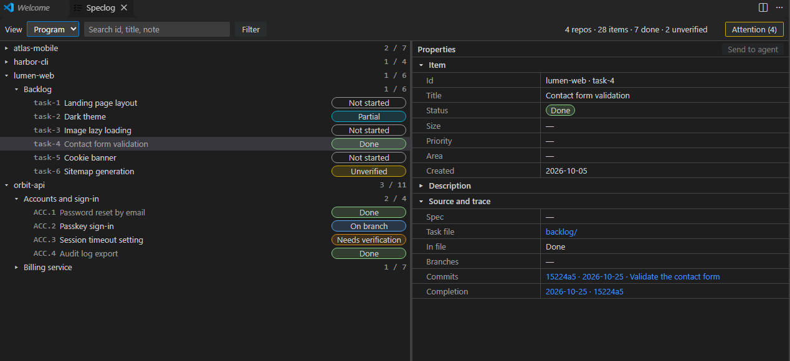
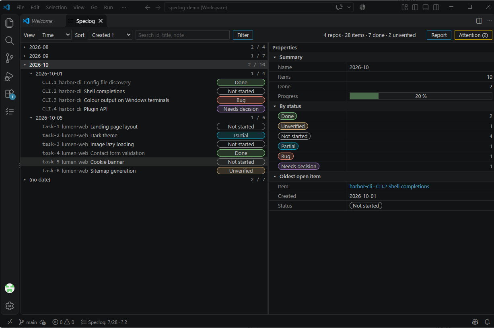

# Speclog

**Is your task list telling the truth? Speclog asks git.**

Speclog is a VS Code extension that shows the tasks of all your git repositories on one screen and
verifies each task's status from git. A task is **Done** only when a commit on the main branch says so
(`Task: <id>` in the commit message). Work that sits on an unmerged branch shows as **On branch**. A
"done" that someone or some agent wrote into a file, with no commit behind it, shows as **Unverified**.

This matters most with AI coding agents. When an agent ticks `[x]` in a Spec Kit `tasks.md` or moves a
Backlog.md task to Done, Speclog shows whether a commit backs that claim and whether the commit has
reached main. A task marked done with no commit behind it shows as **Unverified** instead of passing as
finished.





*Screenshots use a generated demo workspace of fictional repositories (`node scripts/demo-workspace.mjs`).*

Speclog reads the formats you already use and never modifies a task file.

## Install

- Marketplace / Open VSX: search for **Speclog** (`geometricaio.speclog`).
- From a file: `code --install-extension speclog-0.1.0.vsix`.

Works in VS Code and VS Code based editors (Antigravity, Cursor, Windsurf, VSCodium) on Windows, macOS
and Linux. Requires git 2.31 or later on the `PATH` of the machine where the workspace runs, and VS
Code 1.90 or newer.

## Task formats

Task files are read **from git** (the main-branch tip, plus items that exist only on unmerged
branches), not from the working tree. Uncommitted changes in task files are shown as one Attention row
and do not change any status. A repository that uses several formats is read in all of them.

### `docs/tasks`

Speclog's own format: one Markdown file per program under `docs/tasks/`.

```markdown
# Initial stiffness: open ends
program: BL52
area: Analysis/Buckling
created: 2026-11-07

## BL52.2 Load-case based buckling
status: open
size: M
note: Selectable but not used.
```

Each item starts with `## <id> <title>`; below it come `status:` (`open`, `partial`, `bug`, `verify`,
`decision`, `dropped`), optional `size:`, `note:`, `depends:`, `evidence:`, `priority:`. `###` headings
group items. `done` is never written by hand: it is computed from git. IDs may contain
`A-Z a-z 0-9 . _ / -` and are case-sensitive.

### Backlog.md

Tested with **Backlog.md v1.55.3**. Reads `backlog/tasks/*.md` and `backlog/completed/` (also the hidden
`.backlog/` folder) and the status names from the backlog config. The first status maps to open, middle
statuses to partial, the last status to "done in the file". The task `id` (for example `task-12`) is
the item ID, matched case-insensitively. The first label becomes the area; milestones become groups.

- YAML aliases in front matter are refused; the file is reported as a syntax issue.
- A custom `backlog_directory` is not supported in v1.
- `archive/` and `drafts/` are skipped.

### GitHub Spec Kit

Tested with **GitHub Spec Kit v1.4.0**. Every `specs/<feature-folder>/tasks.md` is a program; `## Phase`
headings are groups; `- [ ] T001 [P] [US1] Description` lines are items, `[x]` means "done in the file".
The ID is `<feature-folder>/T001` and is case-sensitive.

## Linking commits to tasks

Put a line in the commit message body:

```
Task: BL52.2                      finishes the item
Task-Progress: BL52.2             links the commit without finishing it
Task: OtherRepo:BL52.2            an item in another repository (name from the origin URL)
Task: owner/OtherRepo:BL52.2      the same, when two repositories share a name
```

Repository names are case-insensitive. Status order: a closing commit on main gives **Done** (dated by the
newest closing commit); otherwise a closing commit on an unmerged branch gives **On branch**; otherwise
the status written in the file. The main branch is the one `origin/HEAD` points to, else `main`, else
`master`; a commit counts as on main when it is reachable from `origin/<main>` or from the local branch.

## For AI coding agents

Agents follow the closing rule when it is in the instructions they read at the start of a session:
`CLAUDE.md` for Claude Code, `AGENTS.md` or your editor's rules file for other agents. Copy this block
into that file:

```markdown
## Tasks

Tasks live in `docs/tasks/*.md`. Their status is verified from git by Speclog
(https://github.com/geometrica-io/Speclog): a task is done only when a commit says so.

- A commit that finishes a task has the line `Task: <id>` in its message body.
- A commit that advances a task without finishing it has the line `Task-Progress: <id>`.
- Never write `status: done` by hand; it is computed from git once the commit reaches the main branch.
- Never change or reuse a task ID.
- For a task in another repository, write `Task: <repo>:<id>`.
```

For Spec Kit or Backlog.md, replace the first paragraph of the block with one of these:

```markdown
Tasks live in `specs/*/tasks.md` (GitHub Spec Kit). Ticking `[x]` is not enough: without a
`Task: <id>` commit the task shows as Unverified. The ID is `<feature-folder>/T001`.
```

```markdown
Tasks live in `backlog/tasks/` (Backlog.md). Moving a task to Done is not enough: without a
`Task: <id>` commit (for example `Task: task-12`) the task shows as Unverified.
```

In these two formats, drop the `status: done` line from the list.

[Send to agent](#send-to-agent) works from the other side: it hands your agent a prompt that already
contains the task and this closing rule.

## Statuses

`Open`, `Partial`, `Bug`, `Verify`, `Decision`, `Dropped`, `Done`, `On branch` and, for Backlog.md and
Spec Kit only, **Unverified**: the file says done but git has no closing commit. Unverified items are
not counted as finished. The `speclog.unverifiedDone` setting chooses how they are shown:

| Value | Effect |
|-------|--------|
| `unverified` (default) | Shown as Unverified, with its own filter and count. |
| `done` | Counted as Done, flagged, and listed under Attention. |
| `open` | The file's "done" is ignored; the item shows as open. |

**Trust current task files.** In a repository that never used `Task:` lines every done item would be
unverified. Run **Speclog: Trust current task files** to store the current main-branch tip as a cutoff
for that repository (kept in Speclog's own storage, nothing is written to the repository). Items that
were already done in the task files at that commit show as **Done (from file)**, and the untagged-work
and manual-done checks start from there. **Speclog: Stop trusting task files** removes the cutoff.

## Attention list

The bottom panel lists what needs a look: stale branches with unmerged task work, commits that changed
code (files outside `docs/` and the task folders of the formats the repository uses) without a `Task:`
line, items whose file status contradicts git (closed in git but still open in the file), items done
only in the file (one summary row per repository; see **Speclog: Trust current task files**), unknown
IDs in `Task:` lines, duplicate IDs, format issues, repositories without
task files, manual `done` after the cutoff, uncommitted task changes, fetch failures and git errors.
The commit-msg hook exempts every format's task folders in every repository, so in a repository that
does not use Backlog.md a commit touching only `backlog/` gets no hook warning but is listed here.

## Send to agent

Select an open item and click **Send to agent** in the property table header (or right-click the item
row, or run **Speclog: Send selected item to agent**). Speclog hands a coding agent a prompt with the
item, its task file, dependencies and spec, and the rule for closing it: a `Task: <id>` line in the
commit that finishes it. Speclog does not track what was sent; the item turns **On branch** and then
**Done** the usual way, from git.

Where the prompt goes is set by `speclog.agent.target`:

- `chat`: VS Code chat opens with the prompt filled in, not sent, so you can edit it and pick the agent.
  The prompt is also copied to the clipboard, in case no agent answers in that chat.
- `terminal`: a new terminal named `Speclog: <id>` opens in the repository and runs
  `speclog.agent.terminalCommand` (default `claude`) with the prompt as one argument. No shell parses
  the prompt, so quotes, `$`, backticks and `%` arrive unchanged. The executable is a name found on
  `PATH` or an absolute path; a relative path (such as `./bin/agent`) is refused with a message, and so is
  an empty or malformed setting (Speclog never falls back to `claude` silently).
- `clipboard`: the prompt is copied; paste it into any agent (Cursor, Windsurf, Antigravity, ...).
- `auto` (default): chat (also copied to the clipboard) when this editor has it, else the clipboard.

Chat is used only when the repository is open in this window; otherwise the prompt is copied and an
**Open repository in new window** button is offered. **Speclog: Copy agent prompt** copies the prompt
whatever the target.

On Windows, npm installs CLIs as `.cmd` launchers, and cmd.exe would mangle a prompt passed to them. A
`.cmd` / `.bat` launcher on Windows, or any prompt over 4,000 characters, gets the prompt through a file:
Speclog writes the prompt to a file in its own extension storage (never in a repository; deleted after
7 days) and passes `Read the task in <file> and follow it.` instead.

Done and dropped items, and repositories with a git error or not scanned yet, cannot be sent (the
button's tooltip says why). A pending decision, dependencies that are not done, work already on a
branch, or an unverified done ask for confirmation first, and the prompt tells the agent about them.

`speclog.agent.promptTemplate` replaces the built-in prompt, for example `/my-skill {repo}:{id}` to call
your own agent skill. Placeholders: `{repo}`, `{repoPath}`, `{id}`, `{title}`, `{status}`, `{size}`,
`{priority}`, `{area}`, `{file}`, `{line}`, `{branch}` (the branch the task file is read from),
`{workBranch}` (the branch to continue on; empty for items on main), `{note}`, `{evidence}`,
`{depends}`, `{spec}`, `{closingRules}` and `{guards}` (the confirmation lines above, for the agent).
Unknown placeholders are left as written and listed in a warning. Guard lines are not added to a custom
template unless it contains `{guards}`.

## Settings

| Setting | Default | Meaning |
|---------|---------|---------|
| `speclog.roots` | `[]` | Folders whose direct child folders are scanned for repositories, in addition to the workspace folders. Absolute paths; `~` is your home folder; relative paths are ignored. |
| `speclog.exclude` | `[]` | Folder names that are never scanned. |
| `speclog.originFilter` | `[]` | Only repositories whose `origin` URL contains one of these fragments (for example `github.com/owner/`). Empty: all. |
| `speclog.fetch.enabled` | `true` | Fetch `origin` in the background. Only `refs/remotes/origin/*` is updated; the working tree is never touched. |
| `speclog.fetch.intervalSeconds` | `300` | Seconds between two background fetches of a repository (minimum 30). |
| `speclog.staleBranchDays` | `7` | A branch with unmerged task work older than this many days is listed under Attention (minimum 1). |
| `speclog.branchDays` | `30` | Only unmerged branches with a commit in the last this many days are read; older branches add no items, show no On branch and no stale row. `0` reads all branches (slow with thousands of branches). Minimum 0. |
| `speclog.unverifiedDone` | `"unverified"` | How a hand-written "done" without a `Task:` commit is shown (see Statuses). |
| `speclog.agent.target` | `"auto"` | Where Send to agent delivers the prompt: `auto`, `chat`, `terminal` or `clipboard` (see Send to agent). |
| `speclog.agent.terminalCommand` | `["claude"]` | The `terminal` target's command: executable first (a name on `PATH` or an absolute path), then fixed arguments (for example `["claude", "--model", "opus"]`). Never split from a string. A per-machine setting (`machine-overridable`). |
| `speclog.agent.promptTemplate` | `""` | A custom prompt with placeholders; empty uses the built-in one. |

Worktrees (where `.git` is a file) are not separate repositories.

## Credentials and fetch

Speclog reads your local clones with local git and never needs a GitHub (or any other) sign-in to show
repositories. The only network operation is the optional background `git fetch --prune origin`. A
repository without an `origin` remote is never fetched and has no fetch state.

Speclog never shows a credential prompt or window: git runs with `GIT_TERMINAL_PROMPT=0`,
`GCM_INTERACTIVE=never` and `credential.interactive=false`, and ssh runs with `BatchMode=yes`. Without
stored credentials the fetch simply fails, quietly, and the board keeps showing the last known state.
When you set `GIT_SSH_COMMAND`, `GIT_SSH` or `core.sshCommand` yourself, Speclog does not override it,
so that command must not prompt (for example, add `-o BatchMode=yes`).

When a fetch fails, the fetch indicator in the top bar turns red and its tooltip lists each repository's
error. If a repository's fetch keeps failing for an hour, it gets a "Fetch failing" row in Attention.
Set `speclog.fetch.enabled` to `false` to turn background fetching off.

## Commands

- **Speclog: Open**
- **Speclog: Refresh**
- **Speclog: Install commit-msg hook in this repository**
- **Speclog: Trust current task files** / **Speclog: Stop trusting task files**
- **Speclog: Send selected item to agent** / **Speclog: Copy agent prompt**

The hook is a portable POSIX `sh` script, installed per repository by the command above. It only warns
(on stderr) when a commit changes files outside the task folders and has no `Task:` / `Task-Progress:`
line; it never blocks a commit. An existing `commit-msg` hook is kept and chained. If `core.hooksPath`
is set, Speclog warns and does not install.

## Remote development

Speclog runs where the workspace is (`extensionKind: workspace`): locally, in Remote-WSL, Remote-SSH and
Dev Containers. Open the folder inside WSL rather than scanning `\\wsl$` paths from Windows (not
supported). Untrusted and virtual workspaces are not supported.

## Relationship to ProjectManager

Speclog succeeds the author's earlier C++/ImGui tool ProjectManager and reads its `docs/tasks` format
unchanged.

## Roadmap

- v1.x: reports (weekly / monthly / range; HTML, PDF, Markdown export).
- v2: GitHub sign-in and lightweight clone of selected repositories.
- v2: a `speclog` CLI and an MCP server for agents.
- Later: open a commit in VS Code's git view from the property table (v1 copies its hash).

## Contributing

```
npm ci
npm run build       # type-check and bundle
npm test            # core and extension unit tests (vitest)
npm run test:ext    # extension smoke test inside VS Code
npm run package     # builds packages/vscode/speclog-<version>.vsix
```

Layout: `packages/core` (VS Code independent, git via `child_process`), `packages/vscode` (extension
and webview). Commit messages are short and imperative, in English.

## License

MIT, copyright Geometrica.io. See [LICENSE](LICENSE).
